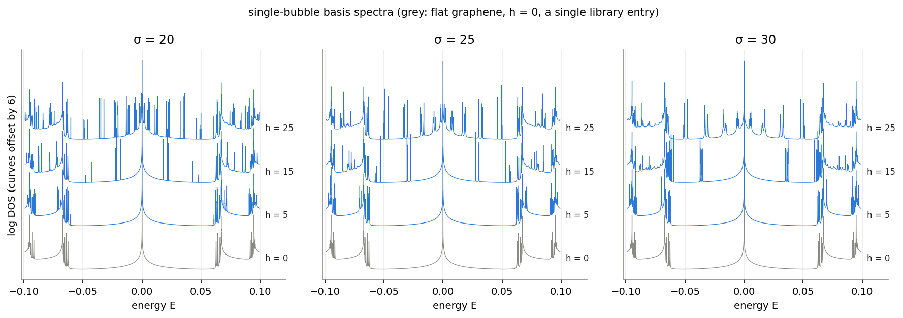
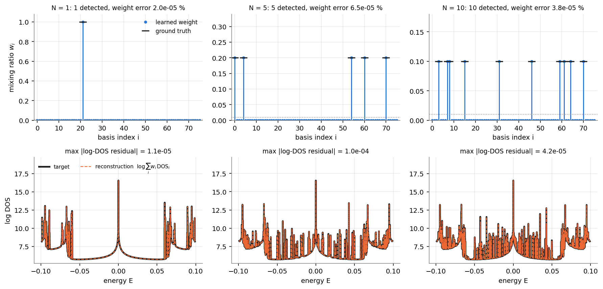
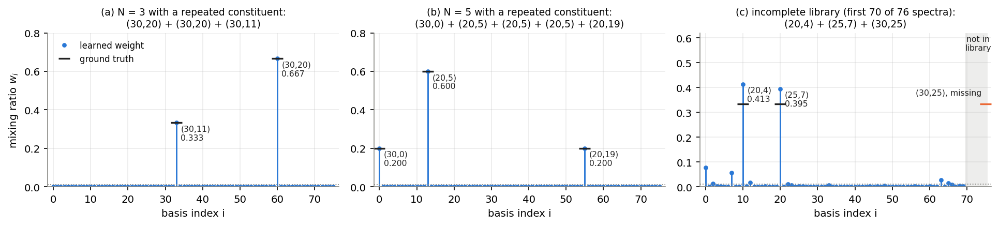
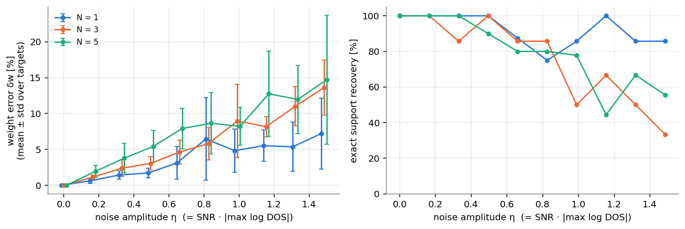
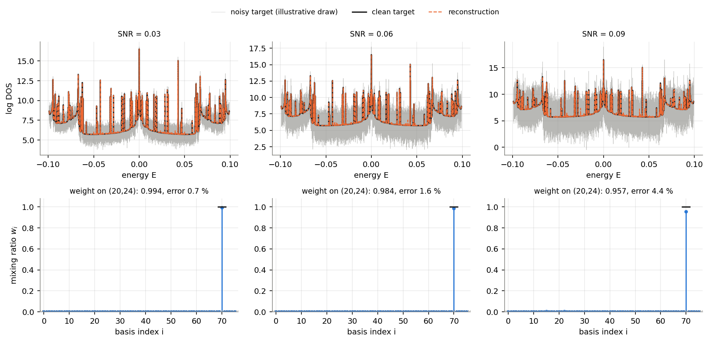
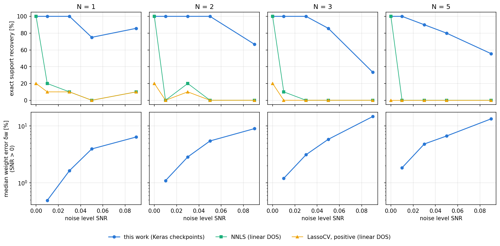

# Decoding multi-nanobubble configurations in graphene

**A physics-constrained single-layer network whose trained weights are the mixing ratios of single-nanobubble spectra, so they show directly which bubbles are present.**

In graphene surface, nanobubbles are formed because of its atomic and thin layer. they are formed with gaussian shape so its sigma and heights are the fingerprint of each bubbles.. The strain shows up as sharp, geometry-dependent features in the electronic density of states (DOS). When several bubbles are present, their features overlap, so it is hard to read off from one spectrum *which* bubbles, and how many, produced it.

For spatially separated nanobubbles, KWANT quantum-transport simulation by our collaborators showed that the multi-bubble DOS is numerically equivalent to the **normalised sum of the constituent single-bubble spectra**. This repository builds that additive relation into a compact model. A target spectrum is decomposed over a library of single-bubble spectra by a single dense layer with non-negative, bounded weights. After fitting, each weight is the mixing ratio of one library geometry $(\sigma, h)$. 

This is the code, the trained checkpoints and the evaluation for
J. Kim, T. Song, and N. Myoung, *Physics-constrained machine learning for decoding multi-nanobubble configurations in graphene*, [arXiv:2607.17866](https://arxiv.org/abs/2607.17866) (2026).

---

## Model

Library: 76 single-bubble DOS spectra $\mathrm{D}_i(E)$ (bubble width $\sigma \in \{20, 25, 30\}$, height $h = 1 \dots 25$, plus flat graphene) on 50 000 energy points. Target: the log-DOS of a configuration $S$ of $N$ bubbles,

$$y(E) = \log \Big( \frac{1}{N} \sum_{i \in S} \mathrm{D}_i(E) \Big).$$

The model is one `Dense(1, use_bias=False)` unit whose inputs at energy $E$ are the 76 library values, trained with

$$\mathcal{L}(\mathbf{w}) = \Big\langle \Big( y(E) - \log \sum_{i=1}^{76} w_i\\mathrm{D}_i(E) \Big)^2 \Big\rangle_E , \qquad 0 \le w_i \le 1 .$$

| element | physical role |
| :-- | :-- |
| sum inside the log | the validated additive relation (linear superposition) for separated bubbles |
| weights clipping ([0,1]) | mixing ratios are fractions. The true solution is $w_i = 1/N$ for each constituent ($k/N$ if a geometry occurs $k$ times) |
| loss on $\log$ DOS | the DOS spans more than four orders of magnitude; the log compares spectra in relative terms, so the sharp resonances do not dominate the fit |
| readout | constituents = $\{i : w_i \ge 0.01\}$, $N_\text{pred}$ = their number, proportions = $w_i$ |

Each target is fitted independently: one network, 76 parameters per spectrum. Training (paper settings) uses Adam, `ReduceLROnPlateau` and early stopping on the loss (see [`nanobubble/`](nanobubble) and [`pretrained/README.md`](pretrained/README.md)). The same objective can also be minimised with L-BFGS-B under box constraints (`nanobubble.fit.solve_bounded`). It reproduces the noise-free checkpoints (max. weight difference $< 10^{-6}$) in seconds instead of minutes, and is used for the large baseline sweep. On three seeded targets (N = 3, SNR = 0 / 0.01 / 0.05), Keras training with the paper settings and L-BFGS-B reach the same loss (agreement to 6 significant digits on the noisy targets), with weights within 0.003 and relative weight errors of 1.74 % vs 1.57 % and 5.98 % vs 5.52 % (Keras vs L-BFGS-B). See [`results/solver_crosscheck.json`](results/solver_crosscheck.json) (`python scripts/compare_baselines.py --crosscheck`).



---

## Results

Unless noted otherwise, all numbers come from `python scripts/evaluate_pretrained.py`. The script reads the 623 checkpoints in [`pretrained/`](pretrained). The ground truth of every checkpoint is encoded in its file name, and the outputs go to [`results/`](results) and [`assets/`](assets). *Relative weight error* is $\lVert \mathbf{w} - \mathbf{w}_\text{true} \rVert_2 / \lVert \mathbf{w}_\text{true} \rVert_2$. *Exact support recovery* means that the set of detected bases ($w_i \ge 0.01$) is exactly the true set.

### 1. Noise-free configurations: exact recovery up to N = 10



| N | 1 | 2 | 3 | 4 | 5 | 6 | 7 | 8 | 9 | 10 |
| :-- | :-: | :-: | :-: | :-: | :-: | :-: | :-: | :-: | :-: | :-: |
| targets | 76 | 26 | 17 | 16 | 17 | 10 | 14 | 20 | 25 | 17 |
| exact support recovery | 100 % | 100 % | 100 % | 100 % | 100 % | 100 % | 100 % | 100 % | 100 % | 100 % |
| max. relative weight error | 6e-4 % | 3e-4 % | 1e-3 % | 2e-4 % | 3e-4 % | 1e-4 % | 3e-4 % | 3e-4 % | 4e-4 % | 2e-4 % |

All 238 random configurations (N = 1: every library spectrum once) are identified exactly. The weights match $1/N$ to better than $10^{-3}$ %, and the error does not grow with the number of bubbles.

### 2. Repeated constituents and an incomplete library



**Repeated constituents (a, b).** If the same geometry occurs twice, the model does not need two basis functions. It puts weight $2/3$ on that geometry, and $1/3$ on the other one. All 78 such targets are recovered exactly: 76 of the form $[i, i, j]$ and two hand-picked cases, e.g. (30,0) + 3×(20,5) + (20,19) → 0.200 / 0.600 / 0.200. The maximum weight error is $2\times10^{-4}$ %.

**Incomplete library (c).** Here the model sees only the first 70 spectra, and every target contains the missing geometry (30, 25):

| target (truth 1/N each) | weights on the constituents that are in the library | other detected bases | $\sum_i w_i$ |
| :-- | :-- | :-: | :-: |
| (30,25) alone | – | 11, largest: flat graphene 0.64, (30,21) 0.14 | 1.13 |
| (20,4) + (25,7) + (30,25) | 0.413, 0.395 (truth 0.333) | 7, largest: flat graphene 0.08 | 1.08 |
| 6 geometries + (30,25) | 0.150 – 0.183 (truth 0.143) | 2, largest: flat graphene 0.02 | 1.04 |

The constituents that are in the library are still found, with the largest weights. The missing spectrum is approximated by a spread of other spectra, mostly flat graphene and bubbles of similar height. The weights then no longer sum to 1, and $N_\text{pred}$ is too large. Spurious detections and a weight sum $\neq 1$ are therefore a usable sign that the library is incomplete.

### 3. Measurement noise

Noise model (paper): Gaussian noise on the log-DOS with standard deviation $\text{SNR}\cdot\lvert\max_E y\rvert$. Because $\max y \approx 16.5$, SNR = 0.01 corresponds to $\sigma_\text{noise} \approx 0.17$ in log-DOS, i.e. multiplicative noise of about 18 %. SNR = 0.09 corresponds to $\sigma_\text{noise} \approx 1.5$.



Trained checkpoints (304 noisy targets, 6–10 per cell; mean relative weight error / exact support recovery):

| SNR | 0.01 | 0.03 | 0.05 | 0.07 | 0.09 |
| :-- | :-: | :-: | :-: | :-: | :-: |
| N = 1 | 0.35 % / 100 % | 0.98 % / 100 % | 3.7 % / 75 % | 3.3 % / 100 % | 4.2 % / 86 % |
| N = 2 | 0.75 % / 100 % | 2.2 % / 100 % | 3.3 % / 100 % | 4.4 % / 83 % | 6.4 % / 67 % |
| N = 3 | 0.89 % / 100 % | 2.3 % / 100 % | 4.2 % / 86 % | 5.8 % / 67 % | 9.7 % / 33 % |
| N = 5 | 1.7 % / 100 % | 4.5 % / 90 % | 7.4 % / 80 % | 10.4 % / 44 % | 11.7 % / 56 % |

The weight error grows roughly linearly with the noise level and with N. It stays at the few-percent level even when the noise visibly buries the spectrum (below). Support recovery is exact at SNR = 0.01 for every N. Above that, the failures are always **false positives**: an extra basis gets a small weight just above the 0.01 threshold, and no true constituent is ever missed (`results/pretrained_scores.csv`).



### 4. Comparison with conventional regression

`python scripts/compare_baselines.py` builds 10 random configurations for each N ∈ {1, 2, 3, 5} (seeded). It adds noise at SNR ∈ {0, 0.01, 0.03, 0.05, 0.09}, giving 200 targets, and decomposes every target with four methods that all use the same detection threshold:

* **this work**: the log-domain objective above (minimised with L-BFGS-B, see *Model*),
* **NNLS** and **LassoCV (positive, no intercept)** on the linear DOS, $e^{y} \approx X\mathbf{w}$, as in the original comparison notebook,
* **NNLS on relative residuals**, $\min \lVert (X\mathbf{w} - e^{y})/e^{y} \rVert^2$, the linearised form of the log loss. It is added to separate the effect of the *relative* comparison from the rest of the method.



Averaged over N (40 targets per column; per-N values in [`results/baseline_summary.csv`](results/baseline_summary.csv)):

| exact support recovery | SNR 0 | 0.01 | 0.03 | 0.05 | 0.09 |
| :-- | :-: | :-: | :-: | :-: | :-: |
| **this work** | **100 %** | **100 %** | 90 % | **80 %** | **52 %** |
| NNLS, relative residuals | 100 % | 100 % | **95 %** | 78 % | 20 % |
| NNLS (linear DOS) | 100 % | 8 % | 8 % | 0 % | 2 % |
| LassoCV, positive (linear DOS) | 15 % | 2 % | 5 % | 0 % | 2 % |

| median relative weight error | SNR 0 | 0.01 | 0.03 | 0.05 | 0.09 |
| :-- | :-: | :-: | :-: | :-: | :-: |
| **this work** | **< 0.001 %** | **0.87 %** | **2.9 %** | **4.6 %** | **8.9 %** |
| NNLS, relative residuals | < 0.001 % | 4.7 % | 33 % | 68 % | 98 % |
| NNLS (linear DOS) | < 0.001 % | 20 % | 67 % | 87 % | 167 % |
| LassoCV, positive (linear DOS) | 8.2 % | 23 % | 85 % | 100 % | 105 % |

* **Linear-space regression breaks down as soon as there is noise.** NNLS is exact on clean data, but at SNR = 0.01 it already fails to recover the support in 92 % of the targets. Its weight error is 20 %, more than 20 times that of the log-domain fit. The fit is dominated by the few energies where the DOS is largest. LassoCV does not recover the support even without noise: the L1 penalty shrinks the true weights, and the cross-validated penalty admits extra bases.
* **Comparing spectra in relative terms is the key ingredient for support recovery.** NNLS on relative residuals matches this work in support recovery up to SNR ≈ 0.05. Its weights, however, are 5–15 times less accurate, because the linearisation is biased under multiplicative noise. At SNR = 0.09 it collapses (20 % vs 52 %).
* The values for this work agree with the Keras checkpoints of §3, e.g. at SNR = 0.05: 80 % exact recovery and a 4.6 % median error here, vs 84 % and a 4.9 % mean error for the checkpoints. The two are different noise draws.

Runtime per target (one CPU core): NNLS 0.3 s, relative NNLS 0.8 s, L-BFGS-B 5 s, LassoCV 12 s. The original Keras training takes 4 min (noise-free) to 20–30 min (noisy) per target on CPU.

### Summary

| question | answer |
| :-- | :-- |
| Do the trained weights identify the configuration? | **Yes.** Exactly for all 316 noise-free targets (N = 1 … 10, repeated constituents) |
| Are the weights quantitatively meaningful? | **Yes.** They equal the mixing ratios $k/N$ to $< 10^{-3}$ % |
| Robust to noise? | Weight error ≈ 1 % at SNR 0.01 and ≈ 5–10 % at SNR 0.09. Support recovery degrades above SNR ≈ 0.03 through false positives |
| Better than conventional regression? | Yes. Much more accurate weights than NNLS / LassoCV / relative NNLS at every noise level > 0, and better support recovery than linear-space NNLS and LassoCV. Relative-residual NNLS is comparable in support recovery up to SNR ≈ 0.05 |

## Limitations

* **Synthetic, in-library targets.** All targets are built from the same library that is used for decoding. The additive model is therefore exact by construction, apart from the incomplete-library test. Real spectra (e.g. STM dI/dV) add broadening, a background, tip effects and geometries that are not in the library. The additive relation itself holds only for spatially separated bubbles.
* **Incomplete library.** A missing geometry is absorbed by several other spectra (§2). The weights then cannot be read as a configuration without further checks (weight sum, residual).
* **Noise.** The fixed threshold of 0.01 produces false positives above SNR ≈ 0.03, and the method gives no uncertainty estimate for the weights. The noise model is Gaussian on log-DOS, scaled to the maximum of the log-DOS. "SNR" is the name used in the paper, not a power ratio.
* **Per-spectrum optimisation.** There is no amortised network; every new spectrum needs its own fit (seconds with L-BFGS-B).
* **Reproducibility of the original runs.** Seeds were not fixed, and the noise realisations of the noisy checkpoints were not stored. The noise numbers in §3 are therefore statistics of those runs, while §4 is fully seeded.

---

## Repository structure

```text
graphene-nanobubble-decoding/
├── nanobubble/                 # small Python package
│   ├── data.py                 #   read .dat files, build the 76-spectrum library, make targets (+ noise)
│   ├── model.py                #   ClipConstraint, log-sum MSE loss, build_model()  (TensorFlow/Keras)
│   ├── fit.py                  #   fit_target() (paper settings, Keras) and solve_bounded() (L-BFGS-B)
│   ├── evaluate.py             #   read checkpoint weights (h5py), parse ground truth, score weights
│   └── baselines.py            #   NNLS, relative NNLS, LassoCV(positive)
├── scripts/
│   ├── evaluate_pretrained.py  # §1–3: all checkpoint numbers and figures
│   ├── compare_baselines.py    # §4: seeded comparison with conventional regression
│   └── train.py                # fit one target (given, random, noisy, or with an incomplete library)
├── notebooks/demo.ipynb        # short executed walkthrough
├── pretrained/                 # 623 checkpoints (17 KB each) + manifest.csv (see pretrained/README.md)
├── data/                       # format description and three sample spectra (see data/README.md)
├── results/                    # CSV / JSON outputs of the scripts
└── assets/                     # figures
```

## Reproducing

```bash
pip install -r requirements.txt

# §1–3 from the shipped checkpoints (weights only; spectrum panels need the DOS library), < 1 min
python scripts/evaluate_pretrained.py --data-dir /path/to/DOS

# §4, needs the DOS library (≈ 15 min on 6 CPU cores)
python scripts/compare_baselines.py --data-dir /path/to/DOS

# fit a single target
python scripts/train.py --data-dir /path/to/DOS --labels 20,4 25,7 30,10                    # Keras, paper settings
python scripts/train.py --data-dir /path/to/DOS --n 5 --seed 3 --snr 0.05 --solver lbfgs     # fast solver
python scripts/train.py --data-dir /path/to/DOS --labels 20,4 25,7 30,25 --n-basis 70        # incomplete library
```

```python
from nanobubble import read_weights, parse_checkpoint_name, BASIS_LABELS

w = read_weights("pretrained/repeated/N3__s30h20+s30h20+s30h11.hdf5")
print({BASIS_LABELS[i]: round(float(w[i]), 4) for i in (w >= 0.01).nonzero()[0]})
# {(30, 11): 0.3333, (30, 20): 0.6667}
```

The single-bubble DOS library comes from the collaborating group's calculations and is not redistributed (available on request; format in [`data/README.md`](data/README.md)). Without it, `evaluate_pretrained.py` still reproduces every weight-based number and figure panel. Tested with Python 3.8, TensorFlow 2.10, NumPy 1.24, SciPy 1.10, scikit-learn 1.3.

## Publication and presentations

* **J. Kim**, T. Song, and N. Myoung, "Physics-constrained machine learning for decoding multi-nanobubble configurations in graphene," [arXiv:2607.17866](https://arxiv.org/abs/2607.17866) (2026).
* *Interpretable Single-Layer Neural Networks for Multi-Nanobubble Characterization in Graphene*: oral, AI4Sci Korea 2026.
* *Interpretable Physics-Constrained Machine Learning for Identifying Multi-Nanobubble Configurations in Graphene*: poster, ICPS 2026, Japan.

```bibtex
@article{kim2026nanobubble,
  title   = {Physics-constrained machine learning for decoding multi-nanobubble configurations in graphene},
  author  = {Kim, Jihye and Song, Taegeun and Myoung, Nojoon},
  journal = {arXiv preprint arXiv:2607.17866},
  year    = {2026}
}
```

A related project applies the same idea, an interpretable single-layer network whose weights carry physical meaning, to signal decomposition with sinusoidal units: [Interpretable-Sine-SLP](https://github.com/jihye-22/interpretable-sine-SLP).

## Acknowledgements

This is a collaborative project, supervised by Prof. Taegeun Song (Department of Data Information and Physics, Kongju National University) and Prof. Nojoon Myoung (Chosun University). The single-nanobubble DOS spectra were provided by Prof. Myoung's group.

Author: **Jihye Kim** · [github.com/jihye-22](https://github.com/jihye-22)
